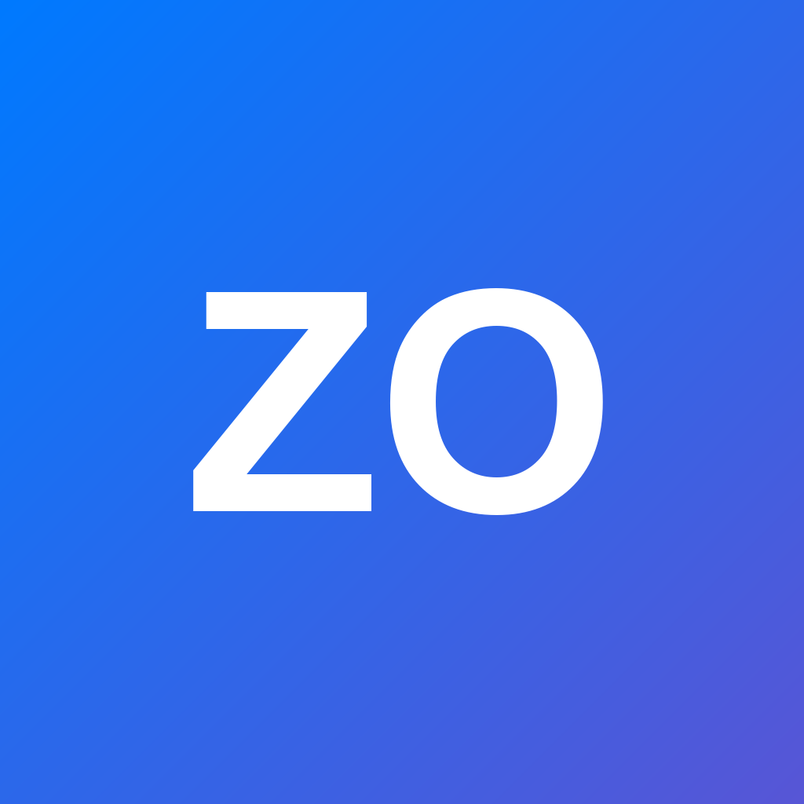

<div align="center">



# ZO 论坛 App

**在手机上浏览、交流与分享。**

uni-app · Vue 3 · Pinia · Discuz 配套 API


<a href="https://www.zozse.cn/"><strong>论坛官网 · www.zozse.cn</strong></a>
<br />
<a href="https://www.z19m.com/"><strong>客户端官网 · www.z19m.com</strong></a>

**本项目版权归 ZO论坛所有。**

[开始开发](#development) · [部署后台](#deployment) · [接口文档](API.md) · [开源检查](OPEN_SOURCE_CHECKLIST.md)

</div>

---

## 功能与范围

| 模块 | 源码实现 |
| --- | --- |
| 论坛浏览 | 首页、版块、关键词搜索、帖子详情与回复分页 |
| 账号服务 | 密码登录、安全问答、注册、短信登录与手机号管理 |
| 内容发布 | 富文本编辑、图片上传、发帖及回复 |
| 互动与消息 | 云端收藏、点赞、通知、私信 |
| 个人中心 | 用户主页、资料设置、密码修改、勋章 |
| 扩展服务 | AI 搜索、每日宝箱、游戏盒子信息；需要相应站点配置和业务表 |
| 体验与更新 | 深浅模式样式、外链处理、图片预览、启动版本检查 |

本仓库包含手机客户端和自编写的 `app_api`。后台依托现有 Discuz 数据库及原生能力，不是独立论坛程序，也不包含桌面客户端。Android 是既有交付平台；虽然 manifest 中存在 iOS/H5 配置，但本次不宣称这些平台完成打包或设备验收。

## 目录

```text
client/                     HBuilderX 打开的 uni-app 项目
  api/index.js              请求封装与 Bearer token
  pages/                    页面与交互
  components/               帖子卡片、正文渲染
  store/                    账号和本地状态
  utils/                    外链与链接处理
  manifest.json             应用标识、版本、原生打包设置
  pages.json                页面路由
server/
  app_api/                  部署到论坛根目录/app_api/
  gamebox_config.php        游戏盒子缺省配置辅助函数
third-party-licenses/       Vue、Pinia、mp-html 原始许可文本
API.md                      请求、鉴权、响应与错误码
OPEN_SOURCE_CHECKLIST.md    本次验证和人工确认事项
```

Discuz、UCenter、商业插件、供应商 SDK、数据库、生产账号配置、App 签名私钥及编译产物不在仓库内。

<a id="development"></a>

## 开始开发

1. 安装支持 Vue 3 uni-app 的 HBuilderX。历史 Android 交付使用 HBuilderX 5.26，本次未重新打包。
2. 获取源码，在 **client** 目录安装依赖。仓库附有 pnpm 9 格式锁文件：

   ```sh
   git clone https://github.com/a2694504525/zo-forum-app.git
   cd zo-forum-app/client
   pnpm install --frozen-lockfile
   ```

   也可以运行 `npm install`，但该方式不会使用 pnpm 锁文件。

3. 在 HBuilderX 中打开 `client/`，通过“运行”菜单选择目标设备，或通过原生 App 发行菜单配置 Android 打包。
4. `package.json` 没有 `dev/start/build` npm 脚本，不要使用不存在的 `npm run dev`。
5. 发布自己的应用前，在 `manifest.json` 使用自己的 DCloud AppID、Android 包名和签名设置。原 AppID 是公开应用标识，不是登录凭据，也不代表获得其云打包或品牌使用权。

原生分享、图片选择、外部浏览器、系统权限和安装升级需要真机验证。签名文件及密码由发布者自己管理，不要提交到仓库。

<a id="deployment"></a>

## 部署后台

### 运行依赖

- 已正常运行的 Discuz 与 UCenter，包含 `config/config_global.php`、`config/config_ucenter.php`、`source/`、`uc_client/`。
- PHP 及 PDO MySQL、JSON、DOM/libxml、mbstring、cURL、GD 等本项目所用扩展；按短信服务配置还可能需要 iconv。请在自己的 PHP/Discuz 组合上测试，本次语法检查使用 PHP 8.5.11，不代表最低版本或全面兼容性保证。
- 数据库用户须能创建并读写代码使用的 `app_*` 辅助表；实际前缀来自 Discuz 配置，不写死为 `pre_`。已有论坛及插件表须由对应程序创建。
- Web 服务器须保留 Authorization 请求头并正确执行 PHP。使用 HTTPS，禁止公开访问配置、日志和备份目录。

### 文件放置

将 `server/app_api/` 复制到 **论坛根目录/app_api/**，将 `server/gamebox_config.php` 复制到论坛根目录同名位置。已有同名文件先备份并比较，不覆盖现有生产配置。

```text
论坛根目录/
  app_api/bootstrap.php
  app_api/app/config.php
  gamebox_config.php
  config/config_global.php   # 你自己的论坛配置，不在仓库内
  source/                   # 你自己的 Discuz 与插件
  uc_client/
```

后台从论坛配置读取数据库凭据，不需要另填 App 数据库密码。程序会按用途创建 token、限流、挑战、收藏、点赞、上传索引和幂等请求等 `app_*` 表；上线前先备份数据库并在测试站验证权限及表结构。

### 换站配置

| 位置 | 需要核对 |
| --- | --- |
| `client/api/index.js` | App 模式 API 基址；H5 模式使用同源 `/app_api/` |
| `client/utils/link.js`、页面和组件 | 论坛链接、头像、外链识别和业务入口 |
| `client/manifest.json` | AppID、包名、应用名称、版本与图标 |
| `server/app_api/bootstrap.php`、`account.php`、`user/medals.php` | 站点、头像和资源默认地址 |
| `server/app_api/app/config.php` | 站点地址与功能声明 |
| `server/app_api/app/release.json` | latest、minimum、force_update、download_url、changelog |
| `server/gamebox_config.php` | 游戏盒子缺省文案和链接，不代表 App 实现了文案中的全部桌面功能 |

可以用 `rg -n 'zozse\.cn|zoscloud\.cn|z19m\.com|__UNI__F18A69D' client server` 找到需逐项审查的原站标识。当前 release.json 的 APK 链接属于原站，换站应改为自己的下载地址。

本项目没有定义 `.env` 环境变量，也没有独立 HTTP 服务启动命令或监听端口。通过既有 Web 服务器部署，不要把示例域名作为自己的生产配置。

### 可选业务依赖

| 能力 | 代码读取的依赖 |
| --- | --- |
| 短信 | `comiis_sms` 插件配置、SDK 和已有 user/temp/log 表；见 `server/app_api/sms.php` |
| 七牛存储 | `addon_storage_qiniuoss` 插件及其 SDK、论坛存储设置；未配置七牛时上传实现含本地存储分支 |
| AI 搜索 | 论坛根目录 `ai-search/config.php`，见下面说明 |
| 每日宝箱 | 既有 `lottery_config`、`lottery_prizes`、`lottery_records` 业务表和论坛积分配置；本仓库不提供这些既有表的初始化 SQL |
| 游戏盒子 | 论坛根目录 `data/gamebox_config.json`；缺省回退至 `gamebox_config.php` |

AI 配置由 `search/ai.php` 读取 `deepseek_api_key`（必需）、`deepseek_api_url`（默认 `https://api.deepseek.com/chat/completions`）、`deepseek_model`（默认 `deepseek-chat`）。请在自己的服务器配置，禁止提交真实密钥；缺少密钥返回业务 code 403。AI 调用会发送问题及检索片段到配置的供应商。

配置端点当前返回固定的功能标识，不会自动验证每个插件/业务表是否可用。部署者应准备相关能力，或同步调整接口功能标识和页面入口，不能仅凭入口显示判断部署完成。

## 联调顺序

1. 在测试站确认论坛网页登录、注册、用户权限和需要的插件正常。
2. 部署文件，访问 `/app_api/app/config.php`、`/app_api/thread/latest.php`，检查 `code/msg/data` JSON。
3. 修改客户端基址，运行 App，核对首页、版块、帖子和分页。
4. 使用自有测试账号验证 Bearer 登录、收藏、消息和权限场景。
5. 发帖、短信、修改资料、积分抽奖会改变真实状态或产生供应商费用，应在授权测试环境逐项验收。
6. 真机完成外链、图片、权限、分享、安装和更新检查后再发行。详见 [接口文档](API.md)。

## 常见问题

| 问题 | 排查方向 |
| --- | --- |
| 接口返回 HTML 或 404 | 路径应为论坛根目录/app_api，检查 PHP、重写与 Web 服务器配置 |
| HTTP 200 但请求失败 | 业务状态在 JSON `code` 中，成功为 0；参见 API.md |
| 登录后仍提示 401 | 检查 Authorization 请求头、token 有效期及账号状态 |
| 数据库报错 | 检查论坛配置、数据库权限和目标插件/业务表是否存在 |
| 短信或 AI 不可用 | 检查服务配置和 SDK，不要把供应商密钥写进客户端 |
| 受限帖子不能访问 | 核对原论坛权限及付费、密码、隐藏内容规则，不要绕过校验 |
| 打包失败 | 确认打开 client 目录、依赖已安装，并使用自己的 AppID、签名与打包账号 |

## 版权、许可与商用

**本项目版权归 ZO论坛所有。**

论坛官网：[www.zozse.cn](https://www.zozse.cn/)

客户端官网：[www.z19m.com](https://www.z19m.com/)

自行编写的代码采用 [MIT](LICENSE)：允许使用、修改、分发、商用及闭源衍生，分发须保留版权和许可声明。MIT 简洁宽松；与 GPL-3.0 相比不要求衍生源码公开，与 Apache-2.0 相比没有同样的明确专利授权条款。

第三方组件、字体、图片、图标、品牌、论坛内容及商业插件遵循各自权利和许可；本项目的代码许可不额外授予这些素材或服务的使用权，见 [第三方声明](THIRD_PARTY_NOTICES.md)。软件按现状提供，不保证适销性或特定用途适用性，责任限制以 LICENSE 为准。

本次检查和仍需人工确认的事项见 [OPEN_SOURCE_CHECKLIST.md](OPEN_SOURCE_CHECKLIST.md)。
